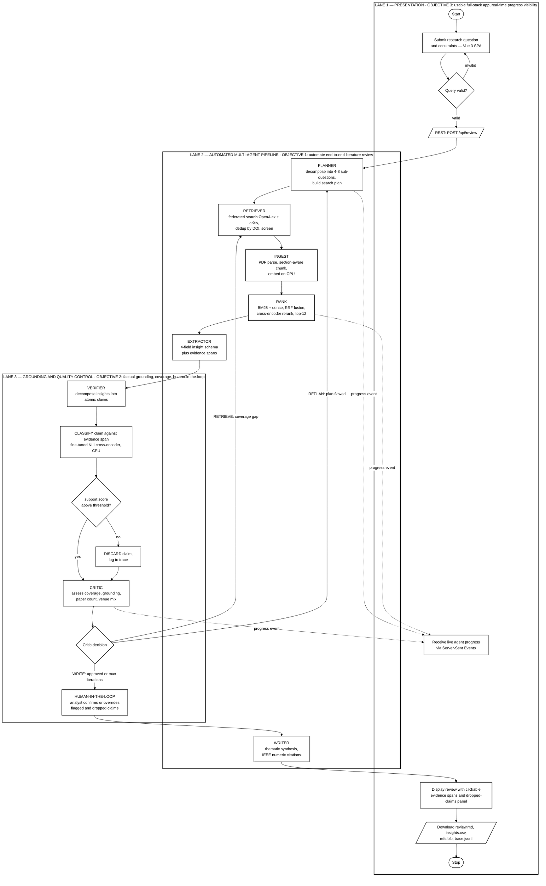
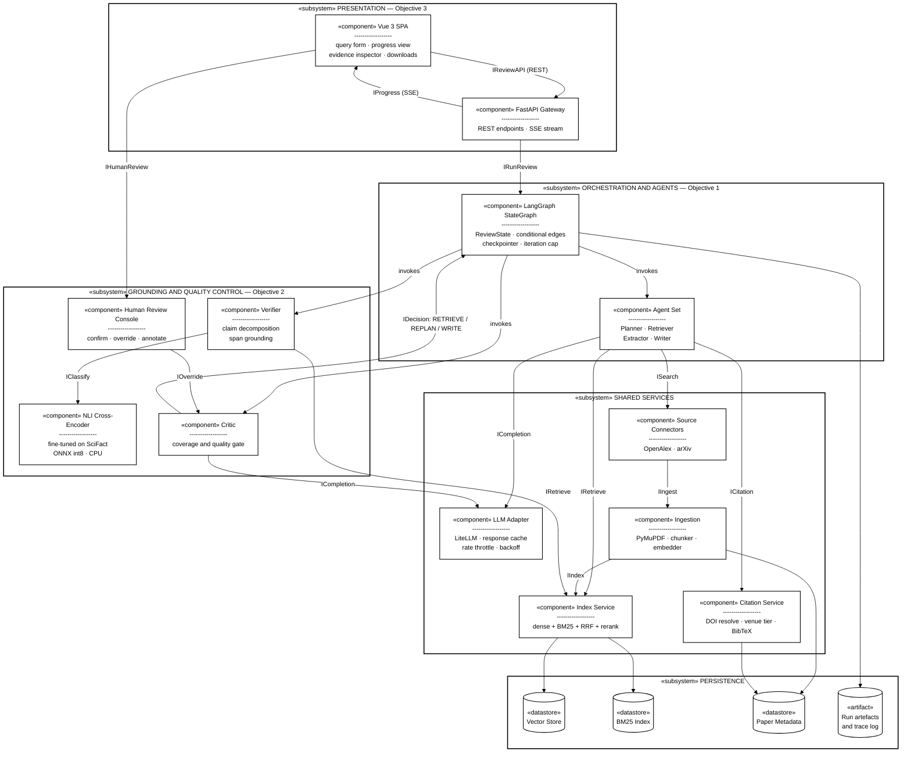
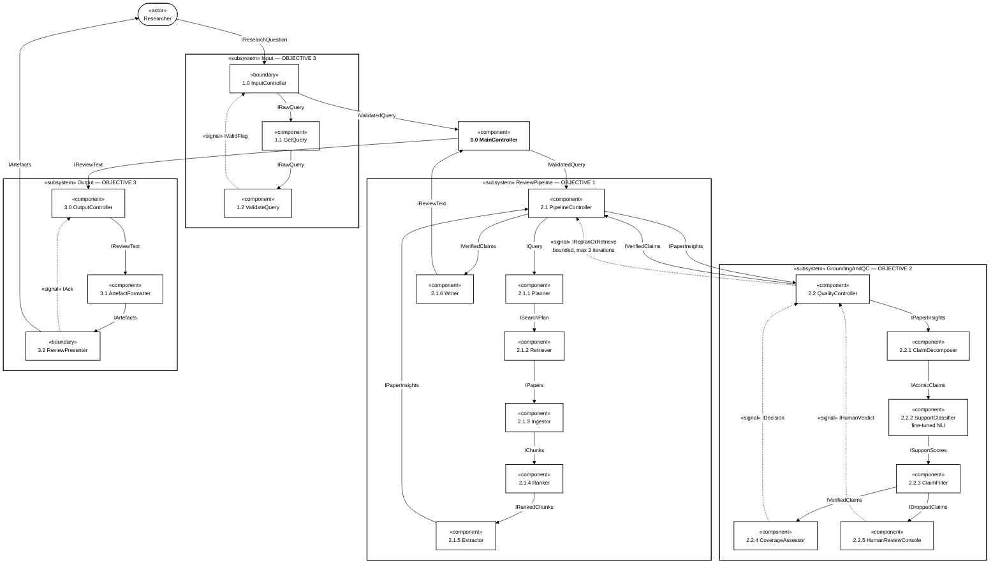
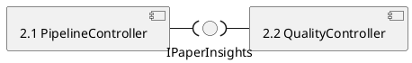

# Architecture Diagram — Review & Corrected UML

> Assessment of `RESEARCHGPT_SPEC.md §3` against the three review rules, plus replacement diagrams.
> Objectives taken from **Review-1 dsc06.pptx, Slide 5**.
> *Created 2026-08-06.*

---

## 1. Verdict

**The underlying design is sound. The diagram is not — it fails all three rules and must be redrawn.**

The six-agent pipeline with a bounded critic loop is well-supported by the literature (see `PAPER_DEEP_DIVE.md`) and needs no structural change. But the diagram in `RESEARCHGPT_SPEC.md §3` was drawn before the Vue/FastAPI requirement existed and before the objectives were written, so it is out of date in ways a reviewer will notice immediately.

| Rule | Status | Core problem |
|---|---|---|
| **1. Clear input → processing → output data flow** | ❌ **Fails** | Input and output are unlabelled floating nodes. Data flow, control flow and dependency are all drawn with different arrows but never distinguished in a legend. |
| **2. UML standard notation** | ❌ **Fails** | It is a Mermaid `flowchart`, not UML. No stereotypes, no interfaces, no partitions, no start/end nodes. |
| **3. Phases inline with the 3 objectives** | ❌ **Fails** | Grouped by *technical layer* (Orchestrator / Service / Persistence), not by objective. **Objective 3 is entirely absent** — no Vue, no FastAPI. **Objective 2's Human-in-the-loop is absent.** |

### The two most serious omissions

1. **Objective 3 does not appear in the architecture at all.** The PPT promises *"a usable full-stack application with real-time progress visibility"*, and slide 8 describes Vue → FastAPI → LangGraph → SSE. None of that is in the diagram. A reviewer comparing slide 5 to slide 7 will see an objective with no architectural support.
2. **Human-in-the-loop is promised in Objective 2 but exists nowhere** — not in the diagram, not in `RESEARCHGPT_SPEC.md`, not in `PROJECT_PLAN.md`. Either put it in the architecture or take it out of the objective. **Recommendation: keep it** — it is cheap (it is the evidence-inspection + dropped-claims panel you are already building) and SurveyGen's Task 3 result shows human-guided generation measurably beats fully automatic.

### Specific defects in the current Mermaid

| Line | Defect |
|---|---|
| `U["Researcher: ..."]` | Input is a bare node outside any boundary — no "INPUT" zone. |
| `OUT["Outputs..."]` | Same for output. Rule 1 asks these to be *depicted*, not implied. |
| `R <--> SRC`, `IDX <--> VS`, `W <--> CIT` | Bidirectional arrows are ambiguous in every notation. In UML you show a **required** and a **provided** interface, or two directed flows. |
| `P -.-> LLM` (×6) | Dotted arrows mean "dependency" here but nothing in the diagram says so. Six of them also add visual noise for one fact ("all agents use the adapter"). |
| `ORCH --> RUN` | A subgraph pointing at a datastore — mixes container and component levels. |
| `SRC` lists 9 connectors | `PROJECT_PLAN.md §2.2` cut this to **OpenAlex + arXiv**. Diagram overstates scope. |
| `IDX["Chroma dense + BM25"]` | PPT slide 3 says **PostgreSQL + pgvector**. Direct contradiction — see §4. |
| No Vue / FastAPI / SSE | Objective 3 unrepresented. |
| No Human-in-the-loop | Objective 2 unrepresented. |
| No trained verifier | The NLI model is your only ML training component; it is invisible. |

---

## 2. Replacement Diagram A — UML Activity Diagram with Partitions ★ use this as the main architecture slide

This is the one to put on slide 7. A UML **activity diagram with swimlane partitions** is the only standard UML form that satisfies all three rules simultaneously: partitions = objectives (Rule 3), activity flow = input→processing→output (Rule 1), and it is standard UML (Rule 2).

Exactly **three partitions**, one per objective. The presentation lane bookends the flow, which is normal and correct in UML — control leaves the user lane and returns to it.

> **Rendering note.** These diagrams are drawn for a **white slide background**: transparent fills, black outlines, black text. If your Mermaid preview is in dark mode, switch it to light or the black text will disappear.

**Why this passes each rule**

- **Rule 1 (input/processing/output).** Explicit `Start`/`Stop` nodes; input activities use the UML parallelogram data shape `[/ /]`; processing is Lanes 2–3; output is the artefact node and display activity. A reader traces one continuous path.
- **Rule 2 (UML).** Standard UML activity-diagram vocabulary: initial node, final node, action nodes, decision nodes (diamonds), object/data nodes, partitions (swimlanes), and control flows. The dashed edges are UML *signal* flows for the SSE progress stream.
- **Rule 3 (objectives).** Three partitions, three objectives, named in the lane titles. Every activity sits under the objective it serves.

---

## 3. Replacement Diagram B — UML Component Diagram (optional second slide)

If your reviewer specifically expects a *component* view rather than a *behavioural* one, add this as a second slide. Uses UML `«stereotype»` notation, provided/required interfaces as labelled dependencies, and `«datastore»` nodes.

### If any fill still shows

Some renderers ignore `themeVariables`. Two fallbacks, in order:

1. **Force it per-node.** Append `,fill:#ffffff` instead of `fill:none` in the `classDef` and `style` lines — an explicit white fill beats a stubborn theme default, and looks identical on a white slide.
2. **Strip the init block** and rely only on the `classDef default` + `style` lines. The init directive is what most third-party viewers mis-handle; the class and style directives are near-universally supported.

For export, [mermaid.live](https://mermaid.live) with the **neutral** theme renders these cleanly and gives you an SVG or PNG to drop straight into the slide. SVG is preferable — it stays sharp when the slide is projected.

---

## 4. Consistency fixes needed before Review-2

The PPT, the spec and the plan currently disagree. Reviewers cross-check slides against documents, so resolve these.

| Item | PPT (Review-1) | `RESEARCHGPT_SPEC.md` | `PROJECT_PLAN.md` | Recommendation |
|---|---|---|---|---|
| **Vector store** | PostgreSQL + **pgvector** | Chroma | Chroma | **Switch PPT to Chroma.** pgvector needs a Postgres service + Docker — real setup cost for ~3k vectors, against your minimal-effort constraint. If you keep pgvector, keep Docker in the requirements too. |
| **Sources** | Semantic Scholar + OpenAlex | 9 connectors | OpenAlex + arXiv | **Use OpenAlex + arXiv.** Semantic Scholar is rate-limited without a key — I hit HTTP 429 on it during the literature search. |
| **Extractor role** | *"Extractor chunks and embeds them"* | 4-field structured insights | 4-field | ⚠️ **Fix the PPT.** Chunking and embedding belong to Ingestion/Retriever. As written, slide 8 describes a system with **no structured extraction at all** — which deletes one of your main contributions. |
| **GPU** | *"GPU: 8GB Minimum"* | — | CPU-only | ⚠️ **Fix the PPT.** Your machine is CPU-only. State: *inference CPU-only; one-time model training on free Kaggle GPU*. As written you have specified hardware you do not have. |
| **Docker** | Required | — | Cut | Only needed if pgvector stays. Drops out with Chroma. |
| **Human-in-the-loop** | In Objective 2 | Absent | Absent | **Add to the architecture** (done in the diagrams above) and to the spec. |
| **Trained NLI verifier** | Absent | Absent | §4.2 | Surface it — it is your only ML training component, and Objective 2 is where it belongs. |
| **Node.js 18+** | Yes | — | Vue 3 + Vite | Consistent. Vite 5+ prefers Node 18+; fine. |

---

## 5. The objectives themselves

**Count is correct — exactly 3.** Content is sound and each maps to a real subsystem. Three refinements:

**Current:**
1. To Automate end-to-end literature review using a multi-agent agentic RAG pipeline.
2. To Ensure factual grounding and coverage completeness via verification and critique loops and Human-in-the-loop.
3. To Deliver a usable full-stack application with real-time progress visibility.

**Suggested:**
1. **To automate** end-to-end literature review using a multi-agent agentic RAG pipeline orchestrated as a stateful graph.
2. **To ensure** factual grounding and coverage completeness through a **fine-tuned claim-verification model**, a bounded critique loop, and human-in-the-loop confirmation.
3. **To deliver** a usable full-stack application with real-time progress visibility and traceable, downloadable review artefacts.

**What changed and why**

- **Capitalisation.** "To Automate / To Ensure / To Deliver" → lowercase. Small, but it is on the slide a reviewer stares at longest.
- **Objective 1** gains *"orchestrated as a stateful graph"* — distinguishes you from a fixed pipeline, which is the actual contribution.
- **Objective 2** gains *"fine-tuned claim-verification model"*. Right now no objective mentions the one component you train, so a reviewer asking *"where is the ML in this project?"* has nothing to point at. It also makes the objective measurable — a trained model has precision/recall numbers, whereas "ensure grounding" does not.
- **Objective 3** gains *"traceable, downloadable review artefacts"* so the objective covers the outputs your architecture actually produces, not only the live view.

**One caution.** Objective 2 promises human-in-the-loop. Keep it *only if you build it.* The cheapest honest version, already in your Vue plan: the dropped-claims panel where the analyst can confirm or override the Verifier's decision before the Writer runs. That is a real HITL step, it is roughly half a day on top of the panel you are already building, and it is what the diagrams above depict.

---

## 6. Module Connectivity Diagram (MCD) — corrected

### 6.1 What is wrong with the current one

`RESEARCHGPT_SPEC.md §4` is a **package-dependency graph** (`graph LR`, six boxes grouped by Python package). It is not a Module Connectivity Diagram in any standard sense:

| Rule | Status | Problem |
|---|---|---|
| **1. Input / processing / output data flow** | ❌ Fails | No input branch, no output branch, no controller. Just packages pointing at each other. |
| **2. Standard MCD notation** | ❌ Fails | The standard is a **structure chart** — hierarchical call tree with ○ data couples and ● control couples. The spec's diagram has no hierarchy, no couples, and modules with multiple parents (`AG7 --- AG1 & AG2 & …`), which violates the one-parent rule. |
| **3. Phases inline with objectives** | ❌ Fails | Grouped by Python package (`researchgpt.core`, `researchgpt.data`, …), not by objective. |

**Your PPT is already closer to correct than the spec is.** Slides 11–12 describe a Main Controller, three branches, one-parent-per-module, and ○/● couples — a real structure chart.

### 6.2 ⚠️ A notation conflict you need to resolve

There is a genuine tension in the brief, and you should know about it before you pick a diagram:

- The **classical** notation for a Module Connectivity Diagram is the **structure chart** (Yourdon/Constantine) — hierarchy, ○ data couples, ● control couples. That is what your slide 12 already describes.
- **A structure chart is not UML.** UML has no structure chart; it was superseded by object-oriented notations.

Since the rule says *standard UML*, the correct UML form for module connectivity is a **Component Diagram at module granularity**, where every module is a `«component»` and every couple becomes a **named interface**. That is what §6.3 gives you. The structure chart is retained in §6.5 in case your rubric actually means the classical notation — **check which your reviewer wants before building the slide.**

**Mapping from structure-chart couples to UML** (this is the key translation, and it is exact):

| Structure chart | UML component diagram |
|---|---|
| Module | `«component»` |
| Invocation (parent → child) | Assembly connector / `«use»` dependency |
| **○ data couple** | **Provided/required interface** carrying that data — named `I<Data>` |
| **● control couple** | **Interface stereotyped `«signal»`** |
| Downward parameter ↓ | Required interface on the caller |
| Upward return ↑ | Provided interface on the callee |

### 6.3 The MCD in standard UML — Component Diagram ★ use this

Legend to put on the slide:

| Notation | Meaning |
|---|---|
| `«component»` | A module |
| `«subsystem»` | Package grouping modules by objective |
| **Solid arrow** + interface name | Assembly connector — data passed via that interface |
| **Dashed arrow** + interface name | `«use»` dependency — control signal, no data payload |
| `«signal»` | Control interface (flag), the UML equivalent of a ● control couple |
| `«boundary»` | System input/output boundary |

**How this satisfies the rules in UML terms**

- **Rule 1.** `«boundary»` components mark the system edge — `1.0 InputController` in, `3.2 ReviewPresenter` out — with an `«actor»` outside both. Every connector carries a named interface, so the data path is explicit end to end: `IResearchQuestion → IValidatedQuery → ISearchPlan → IPapers → IChunks → IRankedChunks → IPaperInsights → IAtomicClaims → ISupportScores → IVerifiedClaims → IReviewText → IArtefacts`.
- **Rule 2.** Standard UML component-diagram vocabulary throughout: `«component»`, `«subsystem»`, `«boundary»`, `«actor»`, `«signal»`, assembly connectors, `«use»` dependencies.
- **Rule 3.** One `«subsystem»` package per objective, named in the package label.

### 6.4 Note on Mermaid and lollipop notation

Mermaid cannot draw true UML ball-and-socket interface symbols (○— provided, —⊂ required). The diagram above uses the **standard simplified form** — a connector labelled with its interface name — which is accepted UML shorthand and is what most tools emit anyway.

If your reviewer insists on literal lollipops, draw it in **draw.io** (`UML → Component`) or **PlantUML**, which support them natively. The PlantUML skeleton is short:

### 6.5 Alternative — classical structure chart (non-UML)

Use this **only** if your rubric means the Yourdon/Constantine notation rather than UML. Same modules, same objective grouping, couple notation matching your slide 12.

| Symbol | Meaning |
|---|---|
| Rectangle | Module (numbered by hierarchy level) |
| Solid line | Invocation — parent calls child |
| **○** | **Data couple** — actual information passed |
| **●** | **Control couple** — a flag or signal (`invoke`, `gap-found`, `valid`) |
| ↓ | Passed *down* to the called module (parameters) |
| ↑ | Returned *up* to the caller |
| Dashed line | Iteration / feedback invocation (bounded loop) |

```mermaid
%%{init: {'theme':'base','themeVariables':{
  'background':'#ffffff','mainBkg':'transparent','primaryColor':'transparent',
  'primaryTextColor':'#000000','primaryBorderColor':'#000000','secondaryColor':'transparent',
  'tertiaryColor':'transparent','lineColor':'#000000','textColor':'#000000',
  'clusterBkg':'transparent','clusterBorder':'#000000','nodeBorder':'#000000',
  'edgeLabelBackground':'#ffffff','fontFamily':'Arial','fontSize':'13px'
}}}%%
flowchart TB
    classDef default fill:none,fill-opacity:0,stroke:#000000,stroke-width:1.4px,color:#000000

    MAIN["<b>0.0  MAIN CONTROLLER</b><br/>ResearchGPT Orchestrator"]

    subgraph BR1["BRANCH 1 · INPUT — Objective 3"]
    direction TB
        I0["<b>1.0</b>  Input Controller"]
        I1["1.1  Get Query"]
        I2["1.2  Validate Query"]
        I0 -->|"↓ ● get<br/>↑ ○ raw_query"| I1
        I0 -->|"↓ ○ raw_query<br/>↑ ○ validated_query<br/>↑ ● valid_flag"| I2
    end

    PROC["<b>2.0  PROCESS REVIEW CONTROLLER</b>"]

    subgraph BR2A["BRANCH 2a · AUTOMATED REVIEW PIPELINE — Objective 1"]
    direction TB
        P0["<b>2.1</b>  Pipeline Controller"]
        P1["2.1.1  Plan Sub-Questions"]
        P2["2.1.2  Retrieve Papers"]
        P3["2.1.3  Ingest and Index"]
        P4["2.1.4  Rank Chunks"]
        P5["2.1.5  Extract Insights"]
        P6["2.1.6  Compose Review"]
        P0 -->|"↓ ○ query<br/>↑ ○ sub_questions, search_plan"| P1
        P0 -->|"↓ ○ search_plan<br/>↑ ○ papers"| P2
        P0 -->|"↓ ○ papers<br/>↑ ○ chunks"| P3
        P0 -->|"↓ ○ chunks, sub_question<br/>↑ ○ ranked_chunks"| P4
        P0 -->|"↓ ○ ranked_chunks<br/>↑ ○ paper_insights"| P5
        P0 -->|"↓ ○ verified_claims, themes<br/>↑ ○ review_text"| P6
    end

    subgraph BR2B["BRANCH 2b · GROUNDING AND QUALITY CONTROL — Objective 2"]
    direction TB
        Q0["<b>2.2</b>  Quality Controller"]
        Q1["2.2.1  Decompose Claims"]
        Q2["2.2.2  Classify Support"]
        Q3["2.2.3  Filter Unsupported"]
        Q4["2.2.4  Assess Coverage"]
        Q5["2.2.5  Human Review"]
        Q0 -->|"↓ ○ paper_insights<br/>↑ ○ atomic_claims"| Q1
        Q0 -->|"↓ ○ claims, evidence_spans<br/>↑ ○ support_scores"| Q2
        Q0 -->|"↓ ○ support_scores<br/>↑ ○ verified_claims<br/>↑ ○ dropped_claims"| Q3
        Q0 -->|"↓ ○ verified_claims<br/>↑ ○ coverage_report<br/>↑ ● decision"| Q4
        Q0 -->|"↓ ○ dropped_claims<br/>↑ ● approve / override"| Q5
    end

    subgraph BR3["BRANCH 3 · OUTPUT — Objective 3"]
    direction TB
        O0["<b>3.0</b>  Output Controller"]
        O1["3.1  Format Artefacts"]
        O2["3.2  Display Review"]
        O0 -->|"↓ ○ review_text<br/>↑ ○ artefacts"| O1
        O0 -->|"↓ ○ artefacts<br/>↑ ● displayed"| O2
    end

    MAIN -->|"↓ ● start<br/>↑ ○ validated_query"| I0
    MAIN -->|"↓ ○ validated_query<br/>↑ ○ final_review"| PROC
    MAIN -->|"↓ ○ final_review<br/>↑ ● ack"| O0

    PROC -->|"↓ ○ query<br/>↑ ○ paper_insights, review_text"| P0
    PROC -->|"↓ ○ paper_insights<br/>↑ ○ verified_claims<br/>↑ ● decision"| Q0

    Q0 -.->|"↓ ● gap-found: re-retrieve / replan<br/>(bounded, max 3 iterations)"| P0

    class MAIN,PROC,I0,I1,I2,P0,P1,P2,P3,P4,P5,P6,Q0,Q1,Q2,Q3,Q4,Q5,O0,O1,O2 default
    style BR1 fill:none,fill-opacity:0,stroke:#000000,stroke-width:2px,color:#000000
    style BR2A fill:none,fill-opacity:0,stroke:#000000,stroke-width:2px,color:#000000
    style BR2B fill:none,fill-opacity:0,stroke:#000000,stroke-width:2px,color:#000000
    style BR3 fill:none,fill-opacity:0,stroke:#000000,stroke-width:2px,color:#000000
```

### 6.6 How the structure-chart version satisfies the three rules

**Rule 1 — input / processing / output.** Three explicitly named branches under one controller. Data is traceable end to end as named couples: `raw_query → validated_query → search_plan → papers → chunks → ranked_chunks → paper_insights → atomic_claims → verified_claims → review_text → artefacts`. A reviewer can follow one variable the whole way down and back.

**Rule 2 — classical notation.** A Yourdon/Constantine structure chart: strict hierarchy, one parent per module, hierarchical numbering (0.0 → 1.0 → 1.1), ○ data couples and ● control couples with ↓/↑ direction, and a dashed feedback invocation for the bounded loop. Same ○/● convention your slide 12 already defines. **Note this is *not* UML** — see §6.2.

**Rule 3 — phases match objectives.** Each branch is labelled with the objective it implements. Objective 3 legitimately appears twice (Input and Output) because it is the presentation layer, which bookends the flow — the top-level split stays exactly the three branches your slide 11 promises.

### 6.7 Two things to check against your slides

1. **Slide 11 currently says the Processing branch "invokes Planner, Retriever, Extractor, Verifier, Critic, and Writer in sequence."** In the corrected chart those six are split across two controllers — 2.1 (Objective 1) and 2.2 (Objective 2) — which is what lets the phases line up with the objectives. Update the wording to match.
2. **The feedback edge is the only non-tree link.** That is correct and intentional — a pure tree cannot express the critic loop — but call it out on the slide as a *bounded* iteration (max 3), otherwise it looks like a violation of the one-parent rule rather than a deliberate control couple.

---

## 7. What to do

1. Replace slide 7 with **Diagram A**; keep slide 8's input/orchestration/processing narration, correcting the Extractor description.
2. Optionally add **Diagram B** as a component view on a new slide.
3. Replace slide 10 with the **UML component diagram in §6.3**, and put its legend on the slide beside it — a component diagram is unreadable without its interface legend. If your rubric turns out to mean the classical (non-UML) MCD, use the structure chart in §6.5 instead. **Confirm which before building the slide** (§6.2).
4. Update slide 11's processing-branch sentence to reflect the 2.1 / 2.2 split (§6.7). Slide 12's ○/● couple explanation needs rewriting too if you go with the UML version — couples become named interfaces there.
5. Fix the PPT contradictions in §4 — the **GPU** and **Extractor role** ones matter most; both are visible errors.
6. Adopt the refined objectives in §5.
7. Add human-in-the-loop to `RESEARCHGPT_SPEC.md §7.5` (Critic) and to `PROJECT_PLAN.md §7.3` (Vue panel 4) so all three documents agree.
8. Replace `RESEARCHGPT_SPEC.md §4` — the package-dependency graph there is genuinely useful as a *code* map, so keep it, but relabel it "Package Dependency Map" and add the structure chart as the actual MCD. They answer different questions and a reviewer will expect the latter.

**Do not change the underlying design.** Six agents, bounded loop, claim-level verification — that structure is right, and `PAPER_DEEP_DIVE.md` now has the citations to defend every part of it.
