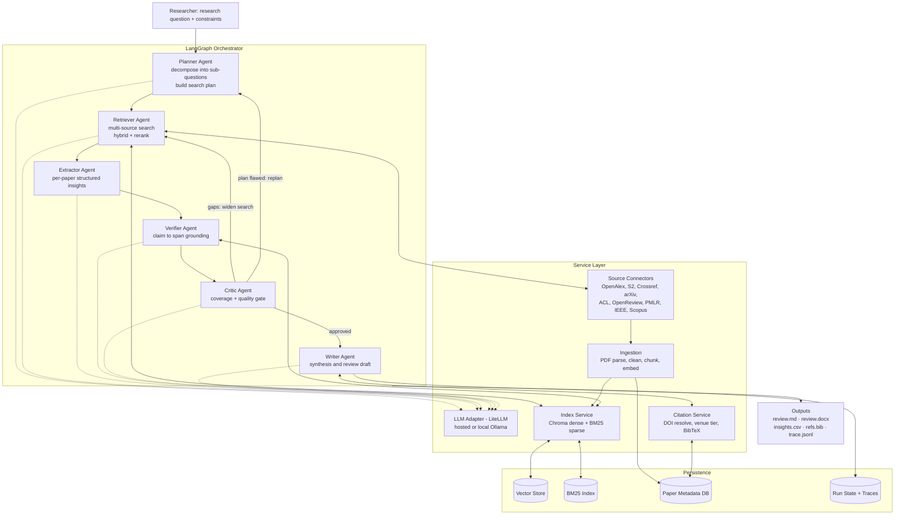
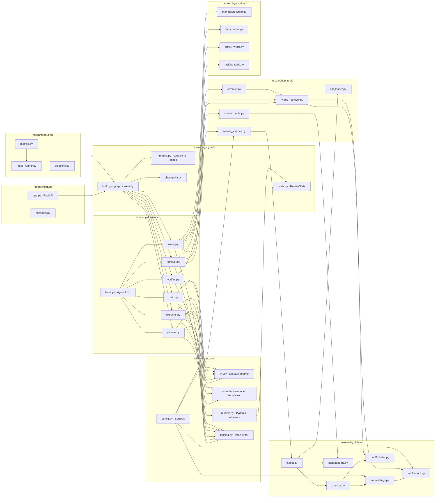
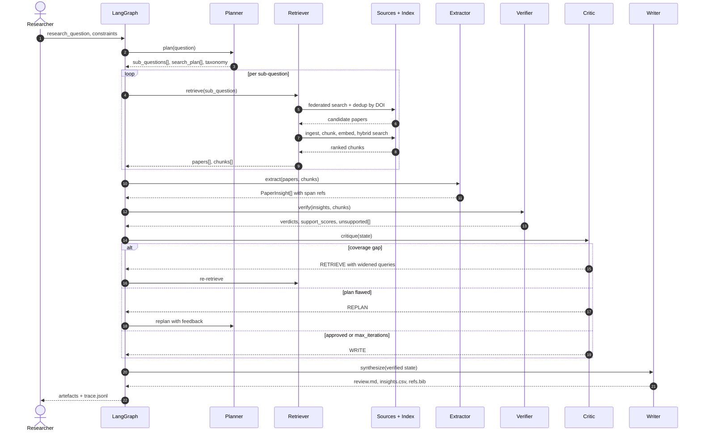
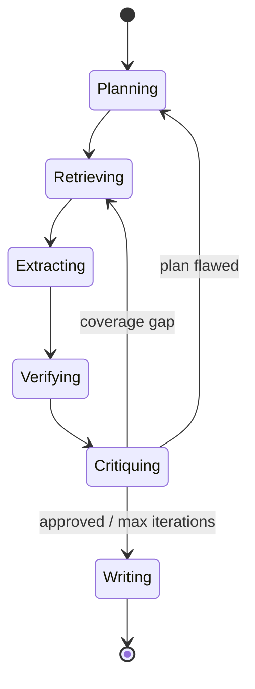

# ResearchGPT — Master Specification & Build Handoff

> **Purpose of this file.** Single source of truth for the ResearchGPT project. Written to be handed to an autonomous coding agent (Claude Code). It contains the research framing, system architecture, agent contracts, data models, repo layout, build order, and acceptance criteria. Place at repo root; reference it from `CLAUDE.md` with `See RESEARCHGPT_SPEC.md for full system spec.`
>
> **Status:** Literature review complete. Implementation not yet started. Build from Phase 0.

---

## 0. TL;DR for the implementing agent

Build a **multi-agent agentic RAG system for automated literature review**. Six agents — Planner, Retriever, Extractor, Verifier, Critic, Writer — orchestrated as a **LangGraph** state machine with a **critic-driven feedback loop**. Input: a research question. Output: a structured, fully-cited literature review (Markdown + DOCX + BibTeX) plus a per-paper structured insight table.

Non-negotiables:

1. **Every claim in the output must be traceable to a retrieved chunk.** Unverifiable claims are dropped, not softened.
2. **Peer-reviewed (Scopus/IEEE/ACL) sources rank above preprints.** Preprints are permitted as secondary technical references and must be labelled as such.
3. **The graph is agentic, not a fixed pipeline.** The Critic can send control back to Planner or Retriever. Loop bound: 3 iterations.
4. **Model-agnostic LLM layer.** All calls route through one adapter so the backend can be swapped (GPT/Claude/Gemma-local) without touching agent logic.

---

## 1. Research framing

### 1.1 Problem
Manual literature review is slow, inconsistent, and does not scale with publication volume. Existing RAG systems answer questions over papers but do not produce *review-grade* artefacts: they lack per-paper structured extraction, cross-paper synthesis, and verifiable citation grounding.

### 1.2 Base paper
**Aytar et al. (2025)**, *Natural Language Processing Journal* (Elsevier, Scopus-indexed) — RAG-based literature assistance.

### 1.3 Extension narrative (must hold in the paper)
The system must be demonstrably more capable than the base paper along articulable dimensions:

| Dimension | Base paper | ResearchGPT |
|---|---|---|
| Retrieval control | Fixed single-pass pipeline | Agentic, replanning, multi-round query reformulation |
| Per-paper output | Free-text summary | Structured 4-field schema: Methodology / Advantages / Disadvantages / Critique |
| Cross-paper reasoning | Absent or shallow | Explicit thematic clustering + contradiction and gap detection |
| Verification | Implicit / none | Dedicated Verifier agent; claim→span grounding with support scores |
| Quality control | None | Critic agent with bounded replan loop and stop criteria |
| Source discipline | Mixed | Venue-tier ranking; preprints demoted and flagged |

### 1.4 Contributions to claim
1. A six-agent agentic RAG architecture for end-to-end automated literature review.
2. A structured per-paper insight schema enabling tabular, comparable extraction at scale.
3. A verification layer providing claim-level citation grounding with quantified support.
4. A critic-driven bounded feedback loop for coverage and quality control.
5. An evaluation protocol for review-generation quality (coverage, grounding, citation accuracy).

### 1.5 Literature review assets (already produced — do not redo)
- 25-paper survey organised into six thematic clusters (Word doc).
- 10-paper IEEE addendum (Word doc).
- Citations verified with DOIs/URLs. Notable resolutions: Du et al. (ICML) via PMLR; Self-RAG via OpenReview; Adaptive-RAG via ACL Anthology.

### 1.6 Thematic clusters (reuse as taxonomy in code and paper)
`C1` RAG foundations · `C2` Agentic & self-reflective RAG · `C3` Multi-agent LLM systems · `C4` Scientific document understanding & IE · `C5` Automated survey/review generation · `C6` Evaluation, grounding & hallucination detection

---

## 2. Technology stack

| Layer | Choice | Notes |
|---|---|---|
| Orchestration | **LangGraph** | Stateful graph, conditional edges, checkpointing |
| Tooling / chains | **LangChain** | Loaders, splitters, retrievers, tool wrappers |
| LLM adapter | **LiteLLM** | One interface; swap providers via config |
| Local inference | **Ollama / ChatOllama**, vLLM, LM Studio | Gemma is the local candidate — *validate architecture on a strong hosted model first, then swap* |
| Vector store | **Chroma** (dev) → **Qdrant** (scale) | Persist to `./data/vectorstore` |
| Lexical index | **BM25** (`rank_bm25`) | For hybrid retrieval |
| Reranker | `BAAI/bge-reranker-v2-m3` (cross-encoder) | CPU-tolerable; optional flag |
| Embeddings | `BAAI/bge-large-en-v1.5` or `text-embedding-3-large` | Config-selectable |
| Validation | **Pydantic v2** | All agent I/O is typed |
| PDF parsing | **PyMuPDF** + **GROBID** (optional) | GROBID for section/reference structure |
| Doc output | **python-docx**, Markdown, **BibTeX** | IEEE citation style |
| API / UI | FastAPI + Streamlit | UI is optional, Phase 6 |
| Tracing | LangSmith or local JSONL run log | Required for the evaluation section |
| Testing | pytest + `vcrpy` cassettes | Deterministic tests, no live API in CI |

**Sources:** Semantic Scholar API, OpenAlex, Crossref, arXiv, PubMed, ACL Anthology, OpenReview, PMLR, IEEE Xplore, Scopus. Free/keyless first (OpenAlex, Crossref, Semantic Scholar, arXiv); keyed sources behind feature flags.

---

## 3. System architecture



---

## 4. Module connectivity



---

## 5. Execution sequence



---

## 6. Data flow through state

```mermaid
flowchart LR
    Q["research_question"] --> SQ["sub_questions[]"]
    SQ --> QP["search_plan[] - query, sources, filters"]
    QP --> CP["candidate_papers[] - raw hits"]
    CP --> DP["deduped_papers[] - DOI keyed"]
    DP --> SP["screened_papers[] - inclusion criteria"]
    SP --> CH["chunks[] - with span offsets"]
    CH --> RC["ranked_chunks[] - hybrid + rerank"]
    RC --> PI["paper_insights[] - 4-field schema"]
    PI --> VC["verified_claims[] - score, evidence"]
    VC --> TH["themes[] - cluster, contradictions, gaps"]
    TH --> DR["draft_sections[]"]
    DR --> FN["final_review + refs.bib + insights.csv"]

    VC -.->|"below threshold"| QP
    TH -.->|"thin coverage"| SQ
```



---

## 7. Agent contracts

Every agent subclasses `Agent` in `agents/base.py` and implements `run(state: ReviewState) -> dict` returning a **partial state update only**. Agents never mutate state in place. Every agent logs `{agent, iteration, input_hash, output_summary, tokens, latency}` to the trace.

### 7.1 Planner
- **In:** `research_question`, `constraints`, optional `critic_feedback`
- **Out:** `sub_questions[]` (4–8), `search_plan[]`, `taxonomy` (seeded from C1–C6), `inclusion_criteria`
- **Behaviour:** decomposes by facet (method / application / evaluation / limitation). Emits per-sub-question source priority and year filters. On replan, must *change* the plan — record a diff, never re-emit an identical plan.

### 7.2 Retriever
- **In:** `search_plan[]`
- **Out:** `papers[]`, `chunks[]`, `retrieval_log`
- **Behaviour:**
  1. Federated search across enabled connectors; normalise to `Paper`.
  2. Dedup by DOI → normalised title+year fallback.
  3. Screen against `inclusion_criteria`; drop out-of-scope early (cheap LLM or heuristic).
  4. Fetch OA PDFs where available; parse, chunk, embed, index.
  5. Hybrid retrieve: dense (k=30) + BM25 (k=30) → RRF fuse → cross-encoder rerank → top-k=12 per sub-question.
  6. Assign `venue_tier` via Citation Service.
- **Rule:** never fabricate metadata. A field that cannot be resolved is `None`, not guessed.

### 7.3 Extractor
- **In:** `papers[]`, `chunks[]`
- **Out:** `paper_insights[]`
- **Schema per paper (the four-field standard):** `methodology`, `advantages`, `disadvantages`, `critique` — plus `datasets`, `metrics`, `results`, `limitations`, `evidence_spans[]`.
- **Rule:** every field carries `evidence_spans` (chunk_id + char offsets). No span → field is `null` with `extraction_note`.

### 7.4 Verifier
- **In:** `paper_insights[]`, `chunks[]`
- **Out:** `verified_claims[]`, `unsupported_claims[]`, `grounding_score`
- **Behaviour:** decompose each insight into atomic claims; retrieve supporting evidence for each; NLI-style judgement → `SUPPORTED` / `PARTIAL` / `UNSUPPORTED` / `CONTRADICTED` with `support_score ∈ [0,1]`. Threshold default `0.7`. Cross-paper contradiction detection produces `contradiction_pairs[]`.
- **Rule:** unsupported claims are **removed** from the write path and logged — never hedged into the output.

### 7.5 Critic
- **In:** full state
- **Out:** `decision ∈ {WRITE, RETRIEVE, REPLAN}`, `feedback`, `coverage_report`
- **Checks:** sub-question coverage ≥ 80%; ≥ `min_papers` (default 20) retained; grounding_score ≥ 0.75; no sub-question with < 2 supporting papers; venue-tier mix acceptable; recency window satisfied.
- **Loop control:** `max_iterations = 3`. On the final iteration force `WRITE` and record unresolved gaps in a *Limitations* section rather than looping forever.

### 7.6 Writer
- **In:** verified state
- **Out:** `review.md`, `review.docx`, `insights.csv`, `refs.bib`
- **Structure:** Abstract · Introduction · Methodology of the review · Thematic sections (one per cluster) · Comparative insight table · Contradictions & open problems · Research gaps · Conclusion · References.
- **Rules:** IEEE numeric citation style `[n]`. Every non-trivial sentence carries ≥1 citation. Preprints marked `[preprint]` in the reference list. No sentence may be written that is not backed by a `verified_claim`.

---

## 8. Core data models (`core/models.py`)

```python
from typing import Literal, Optional
from pydantic import BaseModel, Field

VenueTier = Literal["scopus_q1", "scopus", "ieee", "acl", "peer_reviewed", "preprint", "unknown"]
Verdict   = Literal["SUPPORTED", "PARTIAL", "UNSUPPORTED", "CONTRADICTED"]
Decision  = Literal["WRITE", "RETRIEVE", "REPLAN"]

class Paper(BaseModel):
    paper_id: str
    doi: Optional[str] = None
    title: str
    authors: list[str] = []
    year: Optional[int] = None
    venue: Optional[str] = None
    venue_tier: VenueTier = "unknown"
    abstract: Optional[str] = None
    url: Optional[str] = None
    pdf_path: Optional[str] = None
    source: str                      # openalex | s2 | arxiv | acl | ieee | scopus ...
    citation_count: Optional[int] = None
    is_preprint: bool = False

class Chunk(BaseModel):
    chunk_id: str
    paper_id: str
    text: str
    section: Optional[str] = None    # abstract | methods | results | ...
    start_char: int
    end_char: int
    embedding_id: Optional[str] = None

class EvidenceSpan(BaseModel):
    chunk_id: str
    quote: str
    start_char: int
    end_char: int

class PaperInsight(BaseModel):
    paper_id: str
    methodology: Optional[str] = None
    advantages: Optional[str] = None
    disadvantages: Optional[str] = None
    critique: Optional[str] = None
    datasets: list[str] = []
    metrics: list[str] = []
    results: Optional[str] = None
    limitations: Optional[str] = None
    cluster: Optional[str] = None            # C1..C6
    evidence_spans: list[EvidenceSpan] = []
    extraction_note: Optional[str] = None

class Claim(BaseModel):
    claim_id: str
    text: str
    paper_ids: list[str]
    verdict: Verdict
    support_score: float = Field(ge=0.0, le=1.0)
    evidence: list[EvidenceSpan] = []

class SubQuestion(BaseModel):
    sq_id: str
    text: str
    facet: str                                # method | application | evaluation | limitation
    covered: bool = False
    supporting_paper_ids: list[str] = []

class SearchTask(BaseModel):
    sq_id: str
    query: str
    sources: list[str]
    year_min: Optional[int] = None
    max_results: int = 25
```

### 8.1 Graph state (`graph/state.py`)

```python
from typing import Annotated, TypedDict
from operator import add

class ReviewState(TypedDict, total=False):
    # input
    research_question: str
    constraints: dict                      # years, venues, max_papers, language
    # planner
    sub_questions: list[SubQuestion]
    search_plan: list[SearchTask]
    inclusion_criteria: list[str]
    # retriever
    papers: Annotated[list[Paper], add]
    chunks: Annotated[list[Chunk], add]
    retrieval_log: Annotated[list[dict], add]
    # extractor / verifier
    paper_insights: list[PaperInsight]
    verified_claims: list[Claim]
    unsupported_claims: list[Claim]
    contradiction_pairs: list[tuple[str, str]]
    grounding_score: float
    # critic
    decision: str
    critic_feedback: str
    coverage_report: dict
    iteration: int
    # writer
    themes: list[dict]
    draft_sections: dict
    final_review: str
    artefacts: dict
```

---

## 9. Graph assembly (`graph/build.py`)

```python
from langgraph.graph import StateGraph, START, END

def route_after_critic(state: ReviewState) -> str:
    if state.get("iteration", 0) >= MAX_ITERATIONS:
        return "writer"
    return {"WRITE": "writer", "RETRIEVE": "retriever", "REPLAN": "planner"}[state["decision"]]

g = StateGraph(ReviewState)
g.add_node("planner",   planner_node)
g.add_node("retriever", retriever_node)
g.add_node("extractor", extractor_node)
g.add_node("verifier",  verifier_node)
g.add_node("critic",    critic_node)
g.add_node("writer",    writer_node)

g.add_edge(START, "planner")
g.add_edge("planner", "retriever")
g.add_edge("retriever", "extractor")
g.add_edge("extractor", "verifier")
g.add_edge("verifier", "critic")
g.add_conditional_edges("critic", route_after_critic,
                        {"writer": "writer", "retriever": "retriever", "planner": "planner"})
g.add_edge("writer", END)

app = g.compile(checkpointer=SqliteSaver.from_conn_string("./data/checkpoints.db"))
```

State diagram:



---

## 10. Repository layout

```
researchgpt/
├── CLAUDE.md
├── RESEARCHGPT_SPEC.md
├── pyproject.toml
├── .env.example
├── configs/
│   ├── default.yaml
│   ├── local_gemma.yaml
│   └── eval.yaml
├── src/researchgpt/
│   ├── core/        llm.py  config.py  models.py  logging.py  prompts/
│   ├── data/        ingest.py chunker.py embeddings.py vectorstore.py bm25_index.py metadata_db.py
│   ├── tools/       search_sources.py hybrid_retriever.py reranker.py pdf_loader.py citation_tools.py
│   ├── agents/      base.py planner.py retriever.py extractor.py verifier.py critic.py writer.py
│   ├── graph/       state.py build.py routing.py checkpoint.py
│   ├── output/      markdown_writer.py docx_writer.py bibtex_writer.py insight_table.py
│   ├── eval/        metrics.py ragas_runner.py ablations.py
│   ├── api/         app.py schemas.py
│   └── cli.py
├── tests/           unit/ integration/ fixtures/ cassettes/
├── data/            raw/ pdfs/ vectorstore/ metadata.db checkpoints.db
├── outputs/         runs/<run_id>/{review.md,review.docx,insights.csv,refs.bib,trace.jsonl}
└── notebooks/       01_ingest.ipynb 02_retrieval_eval.ipynb 03_ablations.ipynb
```

### 10.1 Config (`configs/default.yaml`)

```yaml
llm:
  provider: openai          # openai | anthropic | ollama
  model: gpt-4o-mini
  planner_model: gpt-4o     # heavier model for planning + critique
  temperature: 0.1
  max_tokens: 4096
embeddings:
  model: BAAI/bge-large-en-v1.5
  device: cpu
retrieval:
  dense_k: 30
  sparse_k: 30
  fusion: rrf
  rerank: true
  reranker: BAAI/bge-reranker-v2-m3
  final_k: 12
  chunk_size: 1200
  chunk_overlap: 200
sources:
  enabled: [openalex, semantic_scholar, arxiv, crossref]
  optional: [ieee, scopus, acl, openreview, pmlr]
  max_per_source: 25
review:
  min_papers: 20
  max_papers: 60
  year_min: 2019
  max_iterations: 3
  grounding_threshold: 0.7
  coverage_threshold: 0.8
output:
  citation_style: ieee
  formats: [markdown, docx, csv, bibtex]
```

---

## 11. Retrieval design

- **Chunking:** section-aware. Split on GROBID/heuristic section boundaries first, then recursive character split at 1200/200. Never merge across papers. Preserve `start_char`/`end_char` for grounding.
- **Hybrid search:** dense (cosine) + BM25, fused with Reciprocal Rank Fusion `score = Σ 1/(60 + rank_i)`.
- **Reranking:** cross-encoder over the fused top-60 → top-12.
- **Query expansion:** Planner emits 2–3 paraphrases per sub-question; union results before fusion.
- **Venue tiering:** boost `scopus_q1 > scopus/ieee/acl > peer_reviewed > preprint`. Applied as a score multiplier, not a hard filter, so strong preprints survive but rank below peer-reviewed work.
- **Dedup:** DOI → normalised `title|year` → embedding cosine > 0.97 on title+abstract.

---

## 12. Evaluation protocol

| Metric | Definition | Target |
|---|---|---|
| Retrieval Recall@k | Fraction of gold papers found in top-k | ≥ 0.80 |
| Precision@k | Relevant among retrieved | ≥ 0.70 |
| Citation accuracy | Citations resolving to a real paper that supports the claim | ≥ 0.95 |
| Groundedness | Sentences with ≥1 supporting span | ≥ 0.90 |
| Coverage | Sub-questions with ≥2 supporting papers | ≥ 0.80 |
| Extraction F1 | Four-field extraction vs. human annotation on 20 papers | ≥ 0.75 |
| Hallucination rate | Claims marked UNSUPPORTED that reach output | 0 by construction; report attempts |
| Cost / latency | Tokens and wall-clock per review | Reported |

**Ablations (required for the paper):**
1. Full system (all six agents).
2. − Critic loop (single pass).
3. − Verifier (no grounding filter).
4. − Agentic planning (single flat query).
5. − Hybrid retrieval (dense only).
6. − Reranker.
7. Baseline: vanilla RAG ≈ base paper configuration.

**Human evaluation:** 3 annotators, 5 reviews, 5-point Likert on coverage / correctness / coherence / usefulness; report Krippendorff's α. Also run RAGAS (faithfulness, answer relevancy, context precision/recall) as an automated cross-check.

---

## 13. Build order

| Phase | Deliverable | Done when |
|---|---|---|
| **0. Scaffold** | Repo, pyproject, config loader, LLM adapter, logging, `Paper`/`Chunk` models, CLI stub | `researchgpt --version` runs; adapter returns a completion from both hosted and Ollama |
| **1. Ingestion + index** | Source connectors (OpenAlex, S2, arXiv, Crossref), PDF parse, chunk, embed, Chroma + BM25 | Query returns ranked chunks with correct span offsets |
| **2. Hybrid retrieval** | RRF fusion, reranker, venue tiering, dedup | Recall@20 ≥ 0.8 on a 30-paper gold set |
| **3. Agents (linear)** | Planner → Retriever → Extractor → Writer wired in LangGraph, no loop | End-to-end run produces a cited draft |
| **4. Verification** | Verifier agent, claim decomposition, support scoring, unsupported filtering | Groundedness ≥ 0.9 on a sample |
| **5. Agentic loop** | Critic agent, conditional edges, checkpointing, iteration cap | Loop demonstrably triggers and terminates on a deliberately under-covered query |
| **6. Output + eval** | DOCX/BibTeX/CSV writers, metrics, ablation runner, optional Streamlit UI | Ablation table reproducible from one command |
| **7. Paper support** | Figures from real traces, results tables, reproducibility script | `make reproduce` regenerates all reported numbers |

---

## 14. Rules for the coding agent

1. **Typed boundaries.** All agent I/O validates through Pydantic. A validation failure is an error, not a warning.
2. **No silent fabrication.** If metadata, a DOI, or a supporting span cannot be resolved, emit `None` and log. Never invent a citation, author, year, or venue.
3. **Partial state updates only.** Agents return dicts merged by LangGraph reducers.
4. **Prompts live in `core/prompts/` as versioned files**, not inline strings. Each prompt file has a header comment stating its agent, version, and expected output schema.
5. **Every LLM call goes through `core/llm.py`.** No direct SDK imports in agent modules.
6. **Deterministic tests.** Record fixtures with `vcrpy`; CI never hits a live API or a paid endpoint.
7. **Bounded loops.** Any retry, replan, or re-retrieve path must have an explicit cap and a forced exit.
8. **Cost guardrails.** Track tokens per run; abort with a clear error above `max_cost_usd` in config.
9. **Respect source terms.** Honour rate limits and robots; use official APIs; store only OA PDFs locally.
10. **Reproducibility.** Every run writes `outputs/runs/<run_id>/` containing config snapshot, trace, and artefacts.

---

## 15. Known risks and mitigations

| Risk | Mitigation |
|---|---|
| Paywalled PDFs limit full-text extraction | Abstract-only degraded mode; flag `text_availability` per paper and report the split |
| API rate limits / key gating (Scopus, IEEE) | Keyless sources are the default path; keyed connectors behind flags |
| Loop non-termination or oscillation | Hard `max_iterations`; require plan diff on replan; forced WRITE on final iteration |
| Cost blow-up from long contexts | Small model for extraction, large model for planning/critique; rerank before sending to LLM |
| Local Gemma underperforms on structured extraction | Validate the architecture on a strong hosted model first; treat local swap as an ablation, not the baseline |
| Extraction schema drift across papers | Strict Pydantic schema + retry-with-repair on parse failure, max 2 repairs |
| Reviewer objection: "just RAG with extra steps" | Ablations 2–5 exist specifically to quantify each agent's contribution |

---

## 16. Open decisions

- Vector store: stay on Chroma or move to Qdrant before Phase 6?
- Whether to run GROBID (better structure, heavier setup) or PyMuPDF-only heuristics.
- Gemma integration timing — after Phase 5 stabilises, as an ablation row.
- Whether the Streamlit UI is in scope for the paper or deferred.

---

*Last updated: 2026-08-06. Amend this file rather than duplicating spec text elsewhere.*
